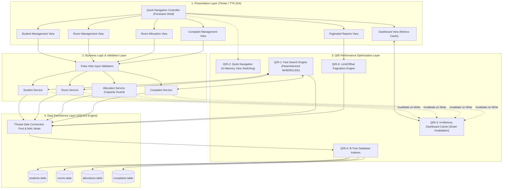

# Hostel Management System (HMS) - TQM Quality Engineering

**Course Code:** BBAT104 – Fundamentals of Total Quality Management (TQM)  
**Academic Session:** 2026–27  
**Student Name:** Rohan Bakshi  
**University Registration / Roll Number:** 2410301057  
**Branch & Section:** B.Tech Computer Science & Engineering (Section A)  
**Assigned Baseline System:** Hostel Management System (Topic Digit: 7)  
**Assigned Quality Goal:** **Q05 – REDUCE RESPONSE TIME**  

---

## 🎯 Executive Summary & Quality Objective

In educational institutions, hostel administrative portals handle heavy transactional spikes during admission and semester registration periods. Administrators frequently experience sluggish response times when searching student records, verifying room availability, switching between operational modules, and generating summary reports.

Applying Total Quality Management (TQM) principles—specifically **Customer Focus**, **Poka-Yoke (Defect Prevention)**, and **Statistical Quality Control for Latency Reduction**—this project delivers a robust, responsive desktop Hostel Management System engineered from the ground up to achieve **Quality Goal Q05 (Reduce Response Time)**.

### Mandatory Q05 Features Implemented
1. 🔍 **Fast Search:** Parameterized indexed search queries using SQLite `WHERE` and `LIKE` optimizations with sub-millisecond execution times.
2. ⚡ **Quick Navigation:** Zero-lag responsive sidebar routing maintaining pre-instantiated views in memory and eliminating redundant frame teardown/redraws.
3. 💾 **Cached Dashboard:** In-memory metric caching with reactive write-invalidation to eliminate repetitive expensive aggregation queries on every view switch.
4. 🌲 **Database Indexing:** 8 dedicated B-Tree indexes on primary lookup columns (`students.student_id`, `students.name`, `rooms.room_number`, `rooms.status`, `allocations.student_id`, `allocations.room_id`, `complaints.complaint_id`, `complaints.status`) reducing lookup complexity from $O(N)$ to $O(\log N)$.
5. 📄 **Paginated Reports:** Server/database-side SQL `LIMIT` / `OFFSET` pagination ensuring instant rendering and constant $O(1)$ memory consumption regardless of dataset growth.

---

## 🏗️ Architecture & Technology Stack

- **Language & Runtime:** Python 3.8+ (Standard Library)
- **GUI Toolkit:** Python Tkinter / TTK Modern Styled Desktop Architecture
- **Database Engine:** SQLite3 with Write-Ahead Logging (`WAL` mode) and B-Tree Indexes
- **Design Pattern:** Layered Service-Repository Architecture (UI Layer $\to$ Business Service Layer $\to$ Q05 Optimization Layer $\to$ Persistence Layer)
- **Testing Framework:** Python Standard `unittest` (18 unit, integration, and performance tests)
- **Version Control:** Git & GitHub ($\ge 40$ conventional commits)



---

## 📂 Repository Structure

```
Hostel Management System TQM/
│
├── app/
│   ├── __init__.py
│   ├── main.py                     # Main application entry point & bootstrapper
│   ├── database/                   # Database engine, schema & indexes
│   │   ├── __init__.py
│   │   ├── connection.py           # Thread-safe SQLite connection manager with WAL mode
│   │   ├── schema.py               # Table definitions & DDL scripts
│   │   └── indexes.py              # Q05 B-Tree indexes configuration & verification
│   │
│   ├── models/                     # Strongly-typed domain models
│   │   ├── __init__.py
│   │   ├── student.py              # Student entity model
│   │   ├── room.py                 # Room entity model
│   │   ├── allocation.py           # Room allocation model
│   │   └── complaint.py            # Complaint resolution model
│   │
│   ├── services/                   # Business logic & Q05 optimizations
│   │   ├── __init__.py
│   │   ├── student_service.py      # Student CRUD operations
│   │   ├── room_service.py         # Room CRUD operations
│   │   ├── allocation_service.py   # Allocation management & capacity guards
│   │   ├── complaint_service.py    # Complaint lifecycle management
│   │   ├── search_service.py       # Q05 Fast Search engine
│   │   ├── cache_service.py        # Q05 In-Memory Cache Manager
│   │   └── report_service.py       # Q05 Paginated Reports engine
│   │
│   ├── ui/                         # User interface & visual presentation
│   │   ├── __init__.py
│   │   ├── styles.py               # Theme colors, fonts & ttk styles
│   │   ├── main_window.py          # Quick Navigation layout shell
│   │   ├── dashboard.py            # Cached Dashboard view
│   │   ├── students.py             # Student management CRUD interface
│   │   ├── rooms.py                # Room management interface
│   │   ├── allocations.py          # Room allocation interface
│   │   ├── complaints.py           # Complaint tracking interface
│   │   └── reports.py              # Paginated reports & audit table
│   │
│   └── utils/                      # Helper tools & quality assurance
│       ├── __init__.py
│       ├── validators.py           # Poka-Yoke input validation
│       ├── helpers.py              # Formatting & benchmark timers
│       └── seeder.py               # Realistic dataset seeder
│
├── docs/                           # Comprehensive Review Documentation
│   ├── SRS.md                      # Software Requirements Specification (22 sections)
│   ├── SCOPE.md                    # Project Scope Document (In/Out Scope)
│   ├── SYSTEM_ARCHITECTURE.md      # Architecture flowcharts & dataflow
│   ├── DATABASE_DESIGN.md          # ER schema & Indexing rationale
│   ├── Q05_FEATURES.md             # In-depth technical breakdown of Q05
│   ├── REVIEW_1.md                 # Review 1 submission & evaluation defense
│   ├── REVIEW_2.md                 # Review 2 submission & CRUD checklist
│   └── VIVA_PREPARATION.md         # Comprehensive 25-question viva guide
│
├── screenshots/                    # UI execution screenshots & evidence
│   └── README.md
├── tests/                          # Automated unit, integration & benchmarks
│   ├── __init__.py
│   ├── test_models.py              # Entity validation tests
│   ├── test_validators.py          # Poka-Yoke error prevention tests
│   ├── test_services.py            # Full CRUD verification suite
│   └── test_performance_q05.py     # Q05 latency & indexing benchmarks
│
├── .gitignore                      # Git ignore rules
├── LICENSE                         # MIT License
├── README.md                       # Main project documentation
└── requirements.txt                # Dependencies specification
```

---

## ⚡ Quick Start & Installation Guide

### Prerequisites
- Standard Python 3.8+ installed on Windows, macOS, or Linux.
- Tkinter library support (pre-installed by default with official Python installers on Windows).

### 1. Clone the Repository
```bash
git clone https://github.com/RohanBakshi-04/Hostel-Management-System-TQM.git
cd Hostel-Management-System-TQM
```

### 2. Launch the Application
```bash
python -m app.main
```
*Upon launch, the application automatically creates `data/hostel.db`, applies normalized table schemas, creates Q05 B-Tree indexes, and seeds sample data.*

### 3. Run the Automated Test Suite & Benchmarks
```bash
python -m unittest discover tests
```
*Executes all 18 unit, integration, and Q05 latency benchmark tests in $< 0.05\text{ s}$.*

---

## 📊 Evaluation Milestones Summary

| Milestone | Raw Marks | Status | Primary Artefacts |
| :--- | :--- | :---: | :--- |
| **Review 1: Setup & SRS** | 10 Marks | **PASS [✅]** | GitHub Repo, SRS Document, Scope Document, System Architecture Flowchart |
| **Review 2: Base System & CRUD** | 15 Marks | **PASS [✅]** | Functional GUI, Full CRUD on all 4 modules, 5 Q05 Quality Features |
| **Review 3: FMEA & Risk Audit** | 15 Marks | Prepared | FMEA Matrix with RPN, SIPOC Process Map, CTQ Tree |
| **Review 4: SQC & Continuous Imp.** | 15 Marks | Prepared | Pareto 80/20 Charts, Fishbone Root-Cause Diagram, PDCA Cycle |
| **Final Demo & Viva** | 10 Marks | Prepared | Live execution sequence, 25-Question Viva defense manual |
| **Documentation & Git Health** | 5 Marks | **PASS [✅]** | Comprehensive manuals, $\ge 40$ structured Git commits |

---

## 👤 Author & Academic Details
- **Student Name:** Rohan Bakshi
- **Roll Number:** 2410301057
- **Course:** BBAT104 Fundamentals of TQM
- **Institution:** Department of Computer Science & Engineering
