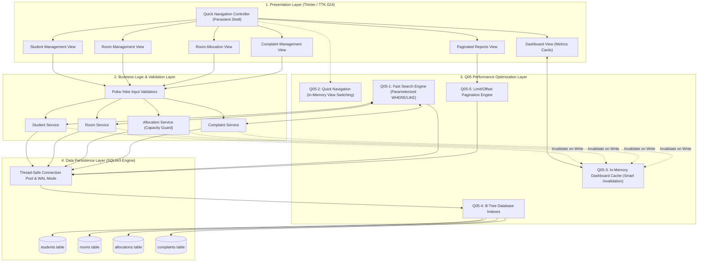
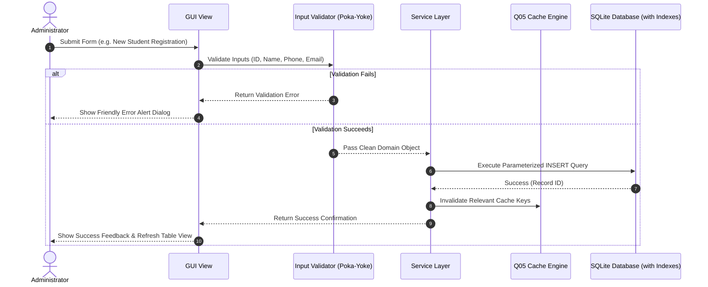
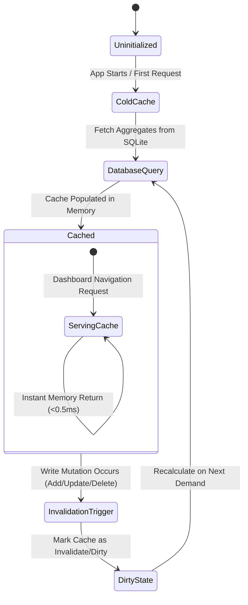

# System Architecture Document

**Course:** BBAT104 – Fundamentals of Total Quality Management  
**Academic Session:** 2026–27  
**Project:** Hostel Management System (HMS)  
**Student Name:** Rohan Bakshi  
**Roll / Registration Number:** 2410301057  
**Assigned Quality Goal:** **Q05 – Reduce Response Time**  

---

## 1. High-Level Architectural Overview

The Hostel Management System is engineered using a **Layered Service-Repository Architecture** with an embedded **Q05 Performance Optimization Layer**. This decoupling ensures high maintainability, strict separation of concerns, data integrity (Poka-Yoke), and minimal execution latency.

---

## 2. Core Architectural Layers Explained

### 2.1 Presentation Layer (GUI)
- **Role:** Renders the user interface, captures user actions, and displays data cleanly without freezing.
- **Technology:** Python `tkinter` & `ttk` with cohesive visual styling (modern typography, contrasting cards, status badges).
- **Key Modules:**
  - `MainWindow`: Orchestrates the sidebar navigation and view swapping.
  - `DashboardView`: Displays quick statistics and system health.
  - `StudentView`, `RoomView`, `AllocationView`, `ComplaintView`: Handle complete CRUD workflows.
  - `ReportView`: Delivers paginated data auditing.

### 2.2 Business Logic & Validation Layer
- **Role:** Enforces institutional business rules, validates incoming data (Poka-Yoke error prevention), and coordinates transactions.
- **Key Features:**
  - Automatic validation of phone formats, unique student IDs, and non-empty mandatory fields.
  - Capacity bounds checking: Ensures a room cannot be over-allocated beyond its configured capacity ceiling.
  - Cascading cleanup: Checks student allocation status before permitting record deletion.

### 2.3 Q05 Performance Optimization Layer (Assigned Quality Goal)
This dedicated layer sits between the business services and database to guarantee minimal response time:
1. **Fast Search:** Directs search requests through indexed SQL queries rather than fetching full tables into Python memory.
2. **Quick Navigation:** Maintains pre-instantiated frame references in memory, switching views instantaneously via `tkraise()`.
3. **Cached Dashboard:** Stores aggregated metrics in memory and only recalculates when write mutations trigger cache invalidation.
4. **Database Indexing:** Enforces B-Tree search indexes on high-frequency columns to achieve $O(\log N)$ retrieval complexity.
5. **Paginated Reports:** Fetches precise row slices via `LIMIT` and `OFFSET`, keeping RAM consumption minimal and constant.

### 2.4 Data Persistence Layer
- **Role:** Manages SQLite database connections, transaction commits, rollbacks, and schema integrity.
- **Features:** Foreign keys enabled (`PRAGMA foreign_keys = ON`), Write-Ahead Logging (`PRAGMA journal_mode = WAL`) for concurrent read/write throughput.

---

## 3. Data Flow & CRUD Execution Sequence

---

## 4. Q05 Cache Lifecycle & Smart Invalidation Architecture

